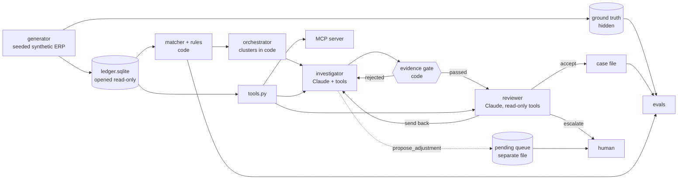

# agentic-ledger-sleuth

An agent that investigates reconciliation exceptions and suspicious transactions in a company ledger, on Claude. Rules find candidates; the agent explains them, closes benign ones with evidence, builds evidence-cited case files for suspicious ones, and can only draft an adjustment for human approval. It never posts.

Built on synthetic data, no customer data. Not affiliated with Anthropic.

**Status.** The rules baseline below is measured. Agent results are **not yet run**: this repository was built without an API key, so the agent has only ever run against a scripted fake, and there is no agent results table because no such numbers exist.

## The problem

A reconciliation team faces thousands of unmatched items and rule alerts, most of them harmless, and the time goes to clearing noise instead of to the few items that matter. Rules are cheap and auditable but cannot read context, and a model can read context but should not be trusted with a ledger or with arithmetic.

## Architecture



The agent loop and the MCP server call the same `call_tool` function, so inputs are validated the same way on both paths. The ground truth lives in a directory no tool has a path to.

## Why the model never does arithmetic

Sums, gaps, differences and counts come from code: `get_ledger_rows` returns `totals`, and findings and open items carry `metrics`. All money is integer minor units. The model copies a number and cites where it came from, and `src/ledger_sleuth/evidence.py` checks it deterministically before any model reviews the file:

- every cited row ID must exist;
- an asserted amount must be supported by the rows cited for it (`each`, `any`, or `sum`, which is re-added in code), and an asserted date must be a value or posting date of those rows;
- any number in free text must trace to the citations, a cited finding's metrics, or an approval limit, so a figure the model worked out for itself is rejected;
- every finding and open item in the cluster needs a disposition, and each disposition must rest on a claim.

A rejected file goes back to the investigator with the errors, a bounded number of times, then to a person. The gate shows that the citations are real, not that the conclusion is right; that is the reviewer's job. It does not parse numbers spelled out as words.

## Why the model never posts

There is no code path to post. `LedgerStore` opens SQLite with `mode=ro` and `query_only`, and the generator leaves the file `0444`. `propose_adjustment` appends a draft with status `pending_human_approval` to a separate JSONL queue, with the approver role computed from the approval matrix. Nothing in the package approves or applies a draft. `tests/test_tools.py` hashes the ledger around every tool call, including SQL-injection strings, and asserts that no tool or public method is named to post or approve.

Drafts behind a case that was rejected, refused or escalated are withdrawn, as are drafts an accepted case did not cite. A cluster whose case is not accepted closes nothing, so a failed agent run degrades to the rules' answer.

## API choices

Written against `claude-opus-5-5` with the official `anthropic` SDK and the Messages API, in `src/ledger_sleuth/agent/loop.py`:

- Adaptive thinking and explicit `output_config.effort`. No `budget_tokens`, sampling parameters, prefill or forced `tool_choice`, all of which this model rejects or does not need.
- `strict: true` tools under default `auto`, with schemas from pydantic models that re-validate every input on the client, since the API does not enforce constraints such as maximums.
- `output_config.format` for the case file and the review verdict, which leaves the tool loop untouched.
- A branch on every `stop_reason`. `refusal` is checked before reading content and becomes an outcome, not a crash.
- `cache_control` on the frozen system prompt, plus automatic caching on the conversation tail. System prompt and tools are byte-identical across clusters, and history is append-only with thinking blocks returned unmodified.
- A manual loop rather than the beta tool runner, because the harness continues a conversation with gate rejections and enforces a turn cap and a per-role tool allowlist at the boundary of each turn. The reviewer is not offered the write tool, and calling it anyway returns an error.
- Both `skills/` files go into the cached system prompt rather than behind a load step. Every investigator needs them, so a load step would add a round trip per cluster to fetch the same text.

The client is injected. Tests use a scripted fake that returns real SDK `Message` objects, and one test runs the genuine SDK over a mock HTTP transport to check what goes on the wire.

## Quickstart

Python 3.11+.

```bash
python3 -m venv .venv && .venv/bin/pip install -e ".[dev]"
make generate        # both seeds; data/ is gitignored and reproducible
make eval-baseline   # offline: no model, no network, no key
make test            # offline: no model, no network, no key
make lint
```

Real output of `make generate`:

```text
.venv/bin/python -m ledger_sleuth.cli generate --seed 1729
seed:           1729
ledger rows:    60602
bank rows:      25313
counterparties: 211
incidents:      122
benign items:   1266
data digest:    ad8873d48fc969e5129c8139ff928bba001c681945891ea8d6ac6d363449eb9d
visible data:   data/seed-1729/public
ground truth:   data/seed-1729/hidden
.venv/bin/python -m ledger_sleuth.cli generate --seed 271828
seed:           271828
ledger rows:    60672
bank rows:      25317
counterparties: 211
incidents:      122
benign items:   1266
data digest:    067d2fc7fe1cf314ee29f6ce689acfaabefb53111d9a159997ec4466fcb9f8ff
visible data:   data/seed-271828/public
ground truth:   data/seed-271828/hidden
```

`pytest`:

```text
137 passed in 15.57s
```

MCP server, on stdio with the official SDK. `make mcp` starts it; `examples/mcp_client_demo.py` starts it as a subprocess and prints:

```text
tools: get_approval_matrix, get_bank_rows, get_counterparty_profile, get_ledger_rows, get_rule_findings, list_open_items, propose_adjustment, run_matcher
not read-only: propose_adjustment
{
  "counts": {
    "fx_difference": 248,
    "matched": 23667,
    "partial_payment": 248,
    "reference_mismatch": 398,
    "timing_difference": 372
  }
}
```

The live agent needs a key and spends tokens. `MAX_CLUSTERS` bounds the run:

```bash
export ANTHROPIC_API_KEY=...
make investigate MAX_CLUSTERS=5   # highest-exposure clusters; case files land in runs/
make eval-agent MAX_CLUSTERS=25   # random sample, scored next to the rules on the same sample
```

Without a key those commands stop before generating anything or touching the network:

```text
.venv/bin/python -m ledger_sleuth.cli eval-agent --seed 271828 --max-clusters 25
ANTHROPIC_API_KEY is not set. The live agent needs it; `eval-baseline` and the test suite do not.
make: *** [eval-agent] Error 2
```

## Measured baseline: rules only

Printed by `make eval-baseline`. `tests/test_readme.py` re-runs it and fails if these blocks drift. Agent results: not yet run.

Scoring, in `src/ledger_sleuth/evals/metrics.py`: a finding is a true positive when it has the incident's typology and overlaps its rows, by vendor for `benford_deviation` and `employee_vendor_overlap`, and by at least two rows for `duplicate_payment` and `invoice_split`, because naming one row of a pair could be coincidence. Recall counts incidents, precision counts findings, and FA/1k rows is false-alarm findings per 1,000 ledger rows. For benign noise, `closed` is what the tolerance rules in `rules/closure.py` close, and `flagged` is how many items also drew a fraud finding.

Train seed (its variant table is omitted here; the command prints it):

<!-- baseline-output -->
```text
== rules baseline, train seed 1729 ==
ledger rows: 60602

typology                   incidents  found  recall  findings    TP  precision  FA/1k rows
duplicate_payment                 24     20    0.83       359    20      0.056       5.594
invoice_split                     16     12    0.75      1611    13      0.008      26.369
bank_detail_change                12      9    0.75        34     9      0.265       0.413
just_below_threshold              24     19    0.79       119    29      0.244       1.485
off_hours_posting                 20     16    0.80      1589    32      0.020      25.692
new_vendor_high_value             12      7    0.58        25     7      0.280       0.297
benford_deviation                  6      5    0.83        22     5      0.227       0.281
employee_vendor_overlap            8      5    0.62        13     5      0.385       0.132
TOTAL                            122     93    0.76      3772   120      0.032      60.262

benign noise                   items  closed  closure  flagged
timing_difference                372     134     0.36       15
fx_difference                    248      87     0.35       16
partial_payment                  248     187     0.75       14
refund                           100      40     0.40       41
typo_reference                   298     298     1.00       15
TOTAL                           1266     746     0.59      101

closures total: 746; closures on a row of a labelled incident: 1
```

Held-out seed:

<!-- baseline-output -->
```text
== rules baseline, held-out seed 271828 ==
ledger rows: 60672

typology                   incidents  found  recall  findings    TP  precision  FA/1k rows
duplicate_payment                 24     20    0.83       354    20      0.056       5.505
invoice_split                     16     11    0.69      1544    11      0.007      25.267
bank_detail_change                12      9    0.75        36     9      0.250       0.445
just_below_threshold              24     19    0.79       149    29      0.195       1.978
off_hours_posting                 20     16    0.80      1634    32      0.020      26.404
new_vendor_high_value             12      7    0.58        28     7      0.250       0.346
benford_deviation                  6      5    0.83        24     5      0.208       0.313
employee_vendor_overlap            8      5    0.62        13     5      0.385       0.132
TOTAL                            122     92    0.75      3782   118      0.031      60.390

benign noise                   items  closed  closure  flagged
timing_difference                372     129     0.35       21
fx_difference                    248     110     0.44       13
partial_payment                  248     183     0.74        9
refund                           100      40     0.40       43
typo_reference                   298     298     1.00       18
TOTAL                           1266     760     0.60      104

closures total: 760; closures on a row of a labelled incident: 2

recall by variant                                     found   of
bank_detail_change / self_verified_fast                   3    3
bank_detail_change / slow_burn                            0    3
bank_detail_change / unverified_fast                      6    6
benford_deviation / blended                               2    2
benford_deviation / low_volume                            0    1
benford_deviation / strong_skew                           3    3
duplicate_payment / cross_company                         4    4
duplicate_payment / late_resubmission                     0    2
duplicate_payment / net_of_fee                            0    2
duplicate_payment / ref_variant_same_amount               6    6
duplicate_payment / same_ref_same_amount                 10   10
employee_vendor_overlap / address_abbreviated             0    2
employee_vendor_overlap / address_exact                   2    2
employee_vendor_overlap / historical_iban                 0    1
employee_vendor_overlap / iban_exact                      3    3
invoice_split / across_companies                          3    4
invoice_split / spread_window                             0    4
invoice_split / tight_window                              8    8
just_below_threshold / repeated_series                    5    5
just_below_threshold / tight_band                        14   14
just_below_threshold / wide_band                          0    5
new_vendor_high_value / aged_shell                        0    3
new_vendor_high_value / fast_high                         7    7
new_vendor_high_value / structured_below                  0    2
off_hours_posting / holiday_business_hours                0    4
off_hours_posting / night_manual                         10   10
off_hours_posting / weekend_manual                        6    6
```

## Where the baseline is weak

This is what the agent is for:

- **Precision.** Most findings are false alarms. `invoice_split` and `off_hours_posting` produce most of them: high-volume vendors whose ordinary invoices fall close together, and month-end close work outside hours. The rules deliberately do not exempt either, because a real case can hide in both.
- **Blind variants.** The zero rows in the variant table are structural: a duplicate net of a fee, a resubmission under a new reference, an amount in a wider band under the limit, a posting in working hours on a public holiday, a vendor just past the new-vendor window, payments structured under the high-value line, a payment well after the bank-detail change, a vendor below the Benford minimum sample, an abbreviated address, an IBAN overlap only in the change history. Widening a threshold finds some of them at a further cost in precision; others need a different kind of check.
- **Thin margins.** `invoice_split / spread_window` differs between the seeds because whether it fires depends on how the parts and unrelated invoices happen to fall.
- **Tolerance closure.** Closing by tolerance is blind to context, and it never closes anything over tolerance however obvious. The low count of closures on a labelled incident's row is weak reassurance: noise lands on incident rows only by chance, and no incident was built to look like a benign exception.

## Limits of these numbers

- The same author wrote the generator and the rules. These numbers describe the rules against this generator, and are not evidence of performance on real ledgers.
- The held-out seed has the same distribution as the train seed. It guards against seed luck, not distribution shift.
- Changes made after first seeing numbers, all fixes rather than tuning: scoring tightened to the two-row requirement above; the split rule's window anchored instead of chained, and its scan corrected so a window that did not fire no longer skips rows (the scan fix came after the first held-out run and did not change recall on either seed); a typo-noise variant that normalised to an identical reference, and so never became an exception, replaced. That last change raised `typo_reference` closure, because items that never became exceptions had been counted as not closed. No generator weight, count or rate was changed to move a score.

## Not done yet

- **No live run.** Prompts have never met the model. Precision, recall, benign-closure rate, cost, turn counts and refusal rate are all unknown, and the first live run may need prompt or schema fixes. Only SDK serialisation is tested, so whether the API accepts these strict schemas as they stand is unverified.
- **Refusals on this domain are unmeasured.** The code handles them; how often financial-crime content triggers one is unknown.
- **Recall is capped by the rules.** A case file can close findings or keep them; it cannot add a new scored finding. The investigator can see some blind spots, for example `employee_links` reports overlaps through IBAN history and similar addresses, but there is no path yet to score what it finds beyond its cluster.
- **Reviewer value is unmeasured.** Nothing yet compares runs with and without it.
- **Prompt injection.** Row text is declared as data in the system prompt, and the agent cannot post, but there is no red-team eval.
- **Execution.** Clusters run sequentially. There is no Batches API path, restart after interruption, or context compaction; clusters are bounded by size and turns instead.
- **CI has not run.** There is no remote yet. The suite ran locally on Python 3.12 and 3.14, not on 3.11.

## Layout

```text
src/ledger_sleuth/
  generator/      seeded ERP: legit flows, labelled anomalies, benign noise, writer
  matcher.py      ledger-to-bank matching, open items
  rules/          one detector per typology, tolerance closure
  tools.py        seven read-only tools, one draft-only write, input validation
  mcp_server.py   the same tools over MCP
  evidence.py     the deterministic gate
  agent/          conversation loop, prompts, schemas, clusters, orchestrator
  evals/          scorer, baseline, live-agent harness
skills/           reconciliation-playbook, fraud-typologies
```

## License

MIT.
